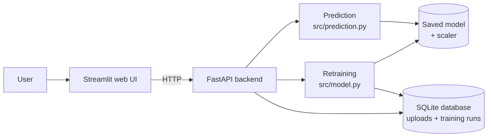

# student-stress-mlop
# Student Stress Level Prediction: ML Pipeline with Retraining

An end-to-end machine learning system that predicts a student's stress level (**Low**, **Medium**, or **High**) from psychological, physiological, environmental, academic, and social factors. It includes a deployed web app, a REST API, and a pipeline for uploading new data and retraining the model.

**Author:** Nazira Umucyo, BSc Software Engineering (Machine Learning), African Leadership University

| | |
|---|---|
| 🌐 **Live app** | https://student-stress-mlop-ercwtgqd8pjusgiowdmofw.streamlit.app/ |
| 🎥 **Video demo** | _Add YouTube link here_ |
| 📓 **Notebook** | [`notebook/stress_prediction.ipynb`](notebook/stress_prediction.ipynb) |

> ⚠️ This is an **educational screening tool, not a diagnostic tool**. It does not replace a mental health professional.

---

## Problem

Stress affects students' health, sleep, relationships, and academic performance, yet it often goes unnoticed until it becomes serious. This project builds a model that flags students who may be under high stress, as an early screening aid that can help students and schools offer support sooner.

## Dataset

- **Source:** [Student Stress Factors: A Comprehensive Analysis](https://www.kaggle.com/datasets/rxnach/student-stress-factors-a-comprehensive-analysis) (Kaggle)
- **Size:** 1,100 students, 20 features, no missing values, balanced classes (373 / 358 / 369)
- **Target:** `stress_level` (0 = Low, 1 = Medium, 2 = High)

| Group | Features |
|---|---|
| Psychological | anxiety level, self-esteem, mental health history, depression |
| Physiological | headache, blood pressure, sleep quality, breathing problems |
| Environmental | noise level, living conditions, safety, basic needs |
| Academic | academic performance, study load, teacher-student relationship, future career concerns |
| Social | social support, peer pressure, extracurricular activities, bullying |

## Model and results

A feed-forward neural network (Keras) was selected from 5 experiments that varied network size, dropout, L2 regularization, and learning rate. The final model uses a 32-16 architecture with **dropout (0.3), L2 regularization, the Adam optimizer, and early stopping**.

**Test-set results (149 unseen students):**

| Model | Accuracy | Loss | Precision | Recall | F1 | ROC-AUC |
|---|---|---|---|---|---|---|
| Baseline (no regularization) | 0.893 | 0.691 | 0.900 | 0.893 | 0.893 | 0.987 |
| **Final model** | **0.886** | **0.266** | **0.896** | **0.886** | **0.887** | **0.990** |

Key findings:
- The baseline overfitted (100% training accuracy). Its accuracy is similar, but its loss is **2.6 times higher**, meaning its probabilities are overconfident and unreliable. The regularized model's confidence scores can be shown to users meaningfully.
- The model finds **96% of highly stressed students** (48 of 50), and its errors lean toward flagging students as high stress, which is the safer direction for a screening tool.
- The strongest stress factors are bullying, future career concerns, anxiety, and depression. The strongest protective factors are self-esteem, sleep quality, and academic performance.

## Features of the app

- **🔮 Predict:** enter the 20 factors with sliders (or load an example student) and get the predicted stress level with class probabilities.
- **🔁 Upload & Retrain:** upload a labelled CSV, which is cleaned and saved to a database, then retrain the model on it. A before/after metrics table and the full retraining history are shown.
- **📊 Data Insights:** three interactive visualizations with explanations: which factors are most linked to stress, any factor compared across stress levels, and sleep quality versus stress.
- **Sidebar:** API status, current model version, and its accuracy and F1 score.

## Architecture



### Retraining pipeline

1. **Upload:** a CSV is uploaded through the UI (or `POST /upload`).
2. **Preprocessing:** columns are validated, values converted to numbers, empty and duplicate rows removed, and values clipped to valid ranges (`src/preprocessing.py`).
3. **Save to database:** cleaned rows are stored in the `uploaded_data` table, marked as not yet used for training.
4. **Retrain:** the **current saved model is loaded as the pre-trained starting point** and fine-tuned on the new data, mixed with a sample of the original training data so it doesn't forget what it learned. A low learning rate (0.0001) and early stopping are used.
5. **Quality check:** the new model is evaluated on the same fixed test set. It replaces the current model only if accuracy drops by no more than 2 points; otherwise the current model is kept.
6. **Versioning:** the previous model is archived, the version number increases, and the run is logged in the `training_runs` table.

## API endpoints

| Method | Endpoint | Description |
|---|---|---|
| GET | `/` | Health check |
| GET | `/model-info` | Current model version, test metrics, database counts |
| POST | `/predict` | Predict the stress level for one student (JSON with 20 values) |
| POST | `/upload` | Upload a labelled CSV; cleaned and saved to the database |
| POST | `/retrain` | Fine-tune the current model on uploaded data |
| GET | `/training-runs` | History of retraining runs |

Interactive documentation (Swagger UI) is available at `http://127.0.0.1:8000/docs` when running locally.

## Project structure

```
student-stress-mlop/
├── notebook/
│   └── stress_prediction.ipynb   # EDA, preprocessing, experiments, evaluation
├── src/
│   ├── preprocessing.py          # data validation, cleaning, scaling
│   ├── prediction.py             # model loading and prediction
│   ├── model.py                  # retraining pipeline
│   └── database.py               # database for uploads and training runs
├── api/
│   └── main.py                   # FastAPI backend
├── app/
│   └── streamlit_app.py          # Streamlit web UI
├── models/                       # saved model, scaler, feature list, metadata
├── data/                         # dataset, train/test splits, retrain and demo samples
├── figures/                      # charts from the notebook
├── Dockerfile, start.sh          # container setup
├── experiments.csv               # results of the 5 training experiments
├── test_results.csv              # final test-set metrics
└── requirements.txt
```

## Run locally

Requires **Python 3.10–3.12**.

```bash
git clone https://github.com/Nazira-umucyo/student-stress-mlop.git
cd student-stress-mlop
pip install -r requirements.txt
```

**Option 1: one command.** The app starts the API automatically in the background:

```bash
streamlit run app/streamlit_app.py
```

**Option 2: API and UI separately** (two terminals):

```bash
uvicorn api.main:app --port 8000      # terminal 1: API, Swagger at /docs
streamlit run app/streamlit_app.py    # terminal 2: web UI at localhost:8501
```

To try retraining, upload `data/retrain_sample.csv`: 110 labelled students that were held out and never used in the original training.

**Option 3: Docker**

```bash
docker build -t student-stress .
docker run -p 7860:7860 student-stress
```

Then open http://localhost:7860.

## Deployment

The app is deployed on **Streamlit Community Cloud**, which builds it directly from this repository. Because Community Cloud runs a single process, the Streamlit app starts the FastAPI server in a background thread, so the UI still communicates with the model through the API.

Notes on the free tier:
- Uploaded data and retrained models are **reset when the app restarts**, since there is no permanent storage. The app always starts from model version 1. In production, the database could be moved to hosted PostgreSQL by setting the `DATABASE_URL` environment variable (supported by `src/database.py`).
- The app **sleeps after 12 hours without visitors**. Click "Yes, get this app back up!" to wake it, which takes about a minute.

## Limitations

- The dataset is small (1,100 students), self-reported, and from a single survey, so results may not transfer to other student populations (for example, students in Rwanda).
- The model shows associations, not causes.
- It is a screening aid, not a diagnosis.

## Tech stack

Python · TensorFlow/Keras · scikit-learn · pandas · FastAPI · Streamlit · SQLAlchemy/SQLite · Altair · Docker
